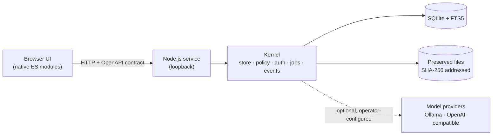

# Archival Intelligence AI

**A free, open-source workbench that helps galleries, libraries, archives and museums (GLAM) use AI on their collections without giving up custody, provenance or editorial control.**

[Website](https://archivalintelligenceai.org) · [Roadmap](#roadmap) · [Getting started](#getting-started) · [License](#license)


> [!NOTE]
> **This repository is the public home of the application and is not yet populated.** Development
> happens in a private repository; tagged releases are published here as clean snapshots, starting
> with **v0.1.0**. Until then this page describes the project and what the first release will contain.
> Watch the repository or visit [ArchivalIntelligenceAI.org](https://archivalintelligenceai.org) for
> the release announcement.

---

## What it is

Archival Intelligence AI is a full-stack web application that runs on an institution's own machine.
It brings the main steps of collection work into one place:

1. **Intake.** Import files and source metadata, preview what will be stored, and record rights decisions before anything is committed.
2. **Preservation.** Keep every original byte-for-byte, with checksums and an append-only event log that detects tampering.
3. **AI assistance.** Run optional local or commercial models for OCR, transcription, description, translation, entity extraction and embeddings. Every result is a *candidate*, never a fact.
4. **Human review.** Compare candidates against the source, correct them, and approve a specific, frozen revision.
5. **Discovery.** Search, browse an evidence-linked graph, and view images, audio, video and text in the browser.
6. **Publication.** Publish only what rights allow, and withdraw it from every public surface at once when they change.
7. **Exchange and recovery.** Export to common archival formats, and back up and restore the whole archive.

## Principles

- **Originals are never overwritten.** Preservation Originals and Interpretive Derivatives are stored and labelled separately; AI and synthetic outputs are always marked as such.
- **Machines propose, people decide.** Model output stays private and provisional until a person approves a revision. Later corrections create new revisions; they never rewrite an approval.
- **Rights fail closed.** Unknown rights block the action in question. Permission to publish, to send material to a remote model, and to use it for AI training are separate decisions.
- **Local first.** The application runs on loopback with an embedded database and plain files. No model service is contacted unless an operator configures one, and nothing falls back silently from a local model to a remote one.
- **Small, auditable supply chain.** Application code is Apache-2.0 with zero npm runtime dependencies.
- **Honest claims.** Release notes state what was verified and how. Model accuracy, accessibility conformance and standards compliance are not claimed without their own evidence.

## What the first release will cover

| Area | Capabilities |
|---|---|
| Collections and intake | Collections with multilingual labels and archival hierarchy; source-preserving import with a no-write preview; safe, idempotent ingest |
| Preservation | SHA-256 content storage, fixity checks, hash-linked event history, crash recovery |
| Rights and access | Independent rights axes and per-action decisions; local roles (researcher, contributor, reviewer, administrator, plus read-only observer and community reviewer) scoped to collections; anonymous public views filtered by policy |
| Model-assisted work | Operator-configured registry for [Ollama](https://ollama.com) and OpenAI-compatible services; durable, governed jobs; side-by-side OCR comparison that preserves disagreement instead of picking a winner |
| Review | Draft, submit, approve or reject immutable annotation revisions; concurrent edits produce a conflict instead of a silent overwrite |
| Discovery | Full-text search with filters; evidence-linked graph with an accessible list view; date and place lenses; native media viewers |
| Publication | Explicit publish and complete withdrawal across item, search, graph, media, manifest and export endpoints |
| Export | Application JSON, JSON-LD, Dublin Core, EAD, IIIF Presentation 3 and BagIt, each as a declared, bounded profile |
| Operations | Job and fixity dashboards, incremental backups to another volume, verified restore into a clean root |

Install, user and administrator manuals and a generated API reference ship with each release.

## Architecture



- **Server:** Node.js 24 or later using the built-in `node:sqlite` module; no framework.
- **Browser:** dependency-free ES modules; keyboard and responsive layouts.
- **Contracts:** a versioned OpenAPI description and JSON Schemas, checked for drift on every build.
- **Data:** a single data root outside the code checkout, holding the database, preserved files and backups.

## Getting started

> Available from v0.1.0. These steps are a preview and may change before the release.

Requirements: macOS or Linux, [Node.js 24+](https://nodejs.org) (Active LTS), and `git`. No package installation is needed.

```sh
git clone https://github.com/jon-chun/aiai-glam.git
cd aiai-glam/app
nvm use            # or any Node.js 24+ on your PATH
npm run demo       # optional: seed clearly labelled synthetic records
npm start          # prints the local URL, data root and token-file path
```

Open `http://127.0.0.1:4173`, choose **Connect as staff**, and paste the token from the file path that `npm start` printed. To keep the archive somewhere specific, set `AIAI_DATA_ROOT` to an absolute path before starting.

Models are optional. Without a model configuration only the built-in deterministic text extractor runs. To add models, copy `config/models.example.json` to `config/models.local.json`, fill in your own installed, digest-pinned models, and set `AIAI_MODEL_CONFIG` to that file.

## Roadmap

**Now: toward v0.1.0**

- Versioned API contracts and schemas, with drift checks in the build gate
- A server-issued capability document, so the browser never decides permissions on its own
- Release tooling that exports an allowlisted, secret-scanned snapshot from a release tag
- Install, user and administrator manuals and the generated API reference

**Next**

- Separate identities for source context and stored artifact, with verified migration of existing archives
- A durable job contract mapped to PREMIS preservation events
- An engine protocol for plug-in recognition engines, starting with a first admitted OCR engine
- A structured value model for richer, typed descriptive metadata
- Evaluated local model profiles for text and image OCR

**Later, as institutions need them**

- Institutional single sign-on and network deployment profiles
- Connectors to existing collection-management systems
- Broader standards profiles (for example METS, PREMIS and OAI-PMH)
- A companion mobile app for capture and review

## Current limitations

- **Pre-1.0 software.** Minor versions may change the HTTP API; release notes will say when.
- **Single-machine, local access control.** Roles and tokens protect a loopback service. This is not institutional identity federation or an internet-facing deployment.
- **No accepted local generative or OCR model yet.** Candidate local models are still being evaluated; the deterministic text extractor and operator-configured commercial services are the current options.
- **Bounded standards support.** Exports implement declared profiles, not entire standards families, and have not been certified by external validators.

## Releases and versioning

Releases follow [semantic versioning](https://semver.org), beginning at `v0.1.0`. Each release is one fresh commit in this repository with a matching annotated tag; release tags are never moved, and a faulty release is followed by a new patch version. Each release is checked for secrets before it is published, and its notes list what was verified and what was not.

## Feedback and contributing

Bug reports, questions and feature requests are welcome in [GitHub Issues](https://github.com/jon-chun/aiai-glam/issues). Because development currently happens in a private repository, pull requests cannot yet be merged directly; a contribution guide will follow the first release. Please do not attach restricted collection material or credentials to public issues.

## License

Code is released under the [Apache License 2.0](LICENSE). Model weights, commercial services, the Node.js runtime and the operating system carry their own terms.

## Acknowledgements

Archival Intelligence AI is supported by the **Schmidt Sciences Humanities and AI Virtual Institute**. It builds on the project's earlier research into GLAM workflows, OCR ensembles, multimodal evidence graphs and human annotation.

Copyright 2026 Jon Chun and the Archival Intelligence AI contributors.
